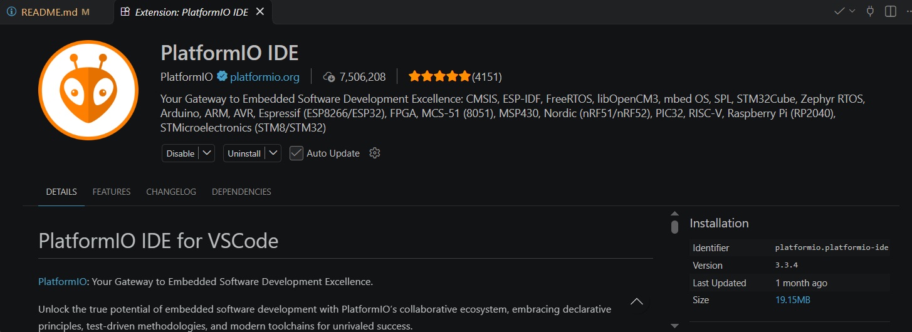
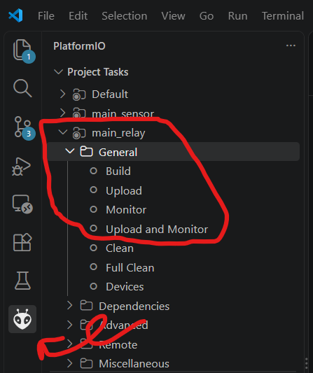
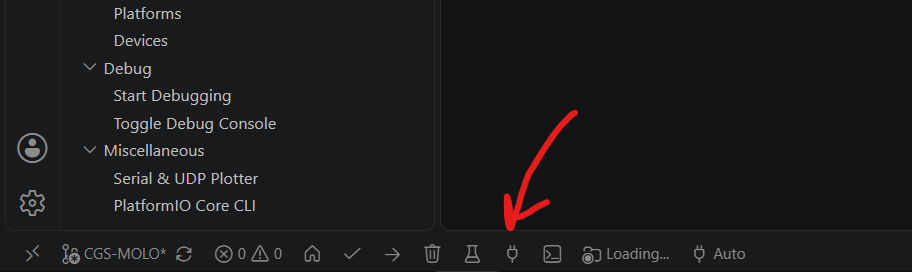

Updated in 2026 by Nabil El Houssein (26elhousse)

# Firmware getting started (MOLONARI1D)

This is the main entry point for firmware developers. Beware of changes.

If you are new here, read this file first. Other README files in subfolders are component details.

## 1) What to edit

- Sensor firmware: `firmware/mains_ino/sensor/main.cpp` & `firmware/mains_ino/sensor/main.hpp`
- Relay firmware: `firmware/mains_ino/relay/main.cpp` & `firmware/mains_ino/relay/main.hpp`
- Shared libraries: `firmware/libs/*`
- Build configuration: `firmware/platformio.ini` (This doesn't necessarily need to be changed a lot, but in case something doesn't work in PlatformIO or you need to configure something for PlatformIO, this is where you can do it)

Note: Each main code file (`main.cpp`) has a respective `main.hpp` that we introduced in 2026. The idea is to follow good coding practices by not having any "magic" numbers or constants inside `main.cpp` without any explanation (for example: `long x = 868000000` in `main.cpp` doesn't indicate anything to the developer and will be hard to understand during a debug session, whereas `constexpr long FREQUENCY_Hz = 868e6` in `LoRaConfig` in `main.hpp` indicates exactly what it is and makes it easy to change once for the whole relay `main.cpp`).

## 2) SD card configuration file (important)

Each board reads a CSV config file from the SD card at boot.

We already left the config files on the SD card of each device (dataloggers and relay) and they were perfectly working. Plus, here are the templates with documentations that we made:
- Sensor config template: `firmware/mains_ino/sensor/conf.csv`
- Relay config template: `firmware/mains_ino/relay/conf.csv`

Then copy the relevant `conf.csv` to the **root of the SD card** before booting the board.

## 3) Option A: Compile/Flash/Monitor in VS Code with PlatformIO

1. Open your cloned repository's `firmware/` folder in VS Code.
2. Download the `PlatformIO` IDE by `PlatformIO` extension in VS Code.

   

3. On the left sidebar, click on the `PlatformIO` extension (it looks like an alien)
4. Click on `main_relay` or `main_sensor` (depending on whether you are building/uploading for a relay or datalogger (sensor)) then `General`.
5. Click on `Build` to build the code.
6. Click on `Upload` or `Upload & Monitor` to flash the code and start monitoring.

   *If upload waits for a new port, double-press reset (tiny white button) on MKR WAN 1310.*

   
 
7. If you want to check the logs and haven't clicked on `Monitor` above, then you can open the `PlatformIO` serial monitor.

   


// Edit 2026: We didn't confirm the below CLI commands because we used the GUI interface

CLI equivalent (from `firmware/`):

```bash
pio run -e main_sensor
pio run -e main_relay
```

### 3. Option B: Arduino IDE upload

*Edit 2026: This section is kept for general information. We know that it is possible to use Arduino IDE because we have used the serial monitor in it. However, we haven't tried uploading from the Arduino IDE itself. We know that uploading is possible but be aware that the `*.ino` files are outdated so if you want to use them, you will have to figure a way to compile all the C++ files into `.ino`.*

If you want to flash with Arduino IDE:

1. Open `hardware/firmware/mains_ino/sensor/sensor.ino` (sensor) or `hardware/firmware/mains_ino/relay/Relay.ino` (relay).
2. In Arduino IDE, select board **Arduino MKR WAN 1310**.
3. Select the correct serial port.
4. Click **Upload**.
5. Keep `conf.csv` on the SD card root.

## 4) Minimal ergonomic workflow

1. Edit `main.cpp` (+ libs if needed).
2. Edit matching `conf.csv`.
3. Compile with PlatformIO in VS Code (`main_sensor` or `main_relay`).
4. Copy `conf.csv` to SD card root.
5. Flash board (PlatformIO or Arduino IDE).

## 5) Where to go next

- Sensor details: `firmware/mains_ino/sensor/README.md`
- Relay details: `firmware/mains_ino/relay/README.md`
- General hardware docs: `hardware/docs/` (Edit 2026: Ask Mr. Flipo for the hardware repository where you will find information for the hardware including the sensors. Here it is just for the firmware code :) )

## Note 2026 on firmware & library Versioning Policy:
`mains_ino/relay/main.hpp`, `mains_ino/sensor/main.hpp`, and every library inside `libs/<library_name>/main.hpp` track their versions independently using Semantic Versioning (`constexpr const char* VERSION = "MAJOR.MINOR.PATCH";`). Every Pull Request targeting `CGS-MOLO` or `main` runs an automated GitHub Action (`.github/workflows/check-version.yml`) that blocks merging if C++ code in `mains_ino/relay/`, `mains_ino/sensor/`, or any library in `libs/` is modified without incrementing VERSION in that specific folder's `main.hpp` (modifying a library only requires updating that library's `main.hpp`, not the relay or sensor). Increment PATCH for bug fixes or refactoring, MINOR for new backwards-compatible features, and MAJOR for breaking changes.

# Contributors
Unfortunately, I don't know the previous contributors to the firmware side of MOLONARI, so I will just start adding from this year's (2026) edition. Feel free to add your name in the list:

## Group "In the Air" 2026
* Nabil El Houssein 😎🇱🇧 (26elhousse)
* Santiago Estrada 🇨🇴 (26estrada)
* Lea Al Haddad 🇱🇧 (26alhaddad)

*This is the final modification from the 2026 "In the Air" team which was made on 15 November 2026. Good luck to the next teams taking over the project!*
