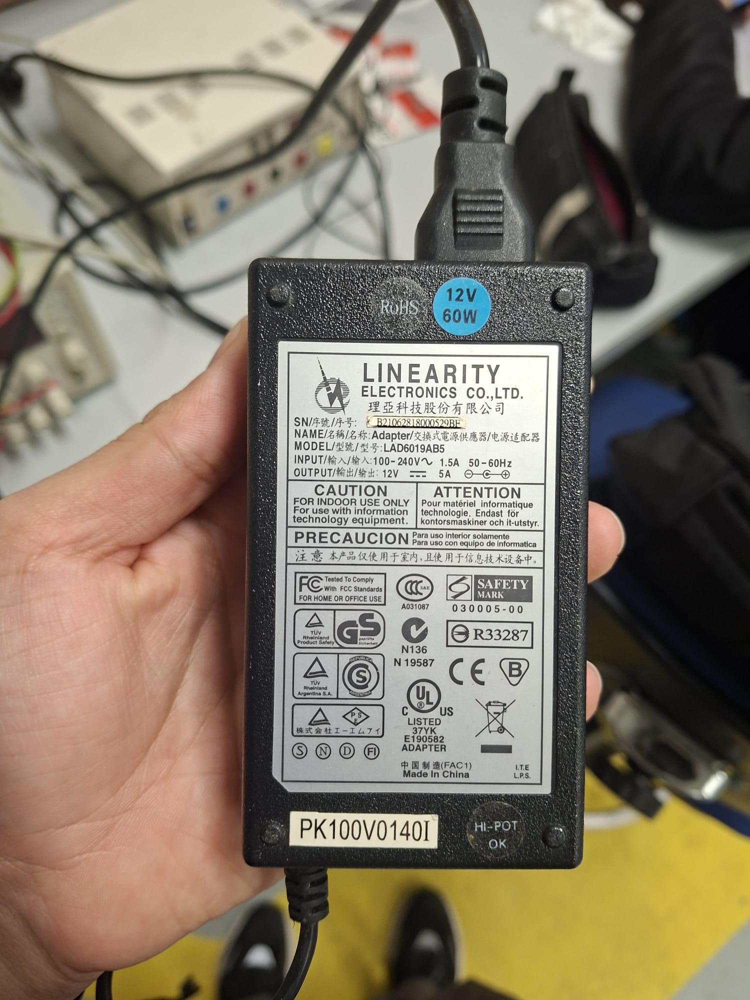
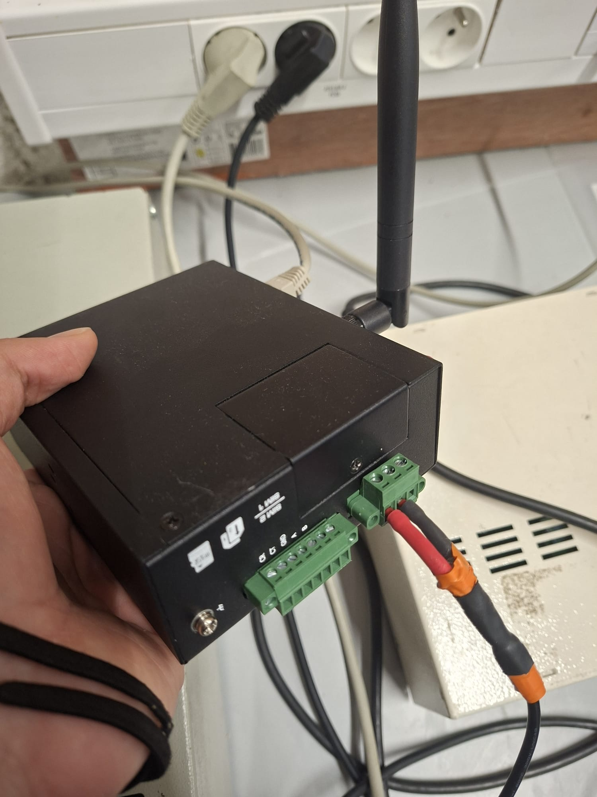
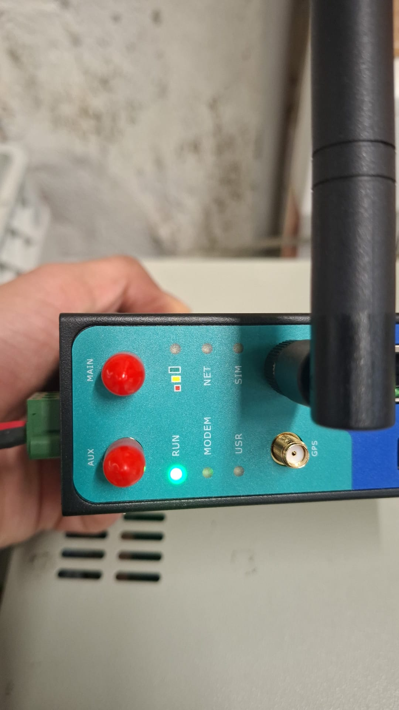
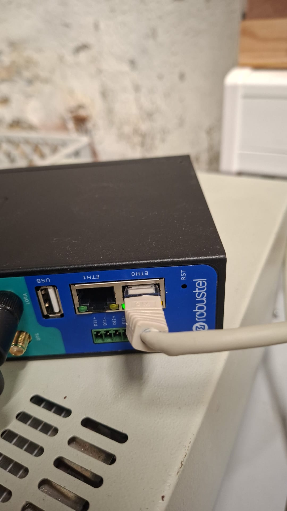

This was done in 2026 by Santiago Estrada (26Estrada)

# Onboarding Robustel R3000 - LG4LA

This is the onboarding guide to the Gateway. I will do my best to make it understandable and funny so you don't get as bored as I did. Whenever an AI intervention occurs (which may happen often), I will mark it down so you know. Call it my work-ethic (I hate reading AI generated content).

## Step 1: Power

Before doing anything, just try plugging the gateway to the powergrid and hope no one broke it. We swear we left it up and running.

If you are rather short-minded like me, you will wonder how the hell we should connect it. For such end, you will need to use the provided power-supply. Since I know your directors (professors whose names I will not mention) will probably not remember the specifics, this image shows what we used:

Branching it is quite easy. You plug it in as the following image shows and that's it.

As soon as you do this, the led on the back that says `RUN` should start blinking every 2 seconds or so.

 At this point, I'm sorry I did not crop the pictures... they take a lot of space but I must finish documenting soon. If you support documentation without AI for human entertaining, you may crop them for future **HUMAN** readers.

## Step 2: Connectivity

Great! You have power. It took humanity centuries to do what you did in 5 minutes. We are now missing connectivity. Take an ethernet cable (Mr. Flipo should have them. If not, ask the IT guys from Mines) and plug one end into `ETH0` and the other end to any wired-internet connection at Mines.

The `NET` section of the Gateway should start blinking. When connection is stablished, it blinks faster than the `RUN` LED.

### Oh no! It doesn't work!

- Notice there are some green and yellowish leds just below `ETH0`. The green one should be stable (indicating power) and the yellow one should blink (indicating communication). If this is not the case, try:

    - Unplugging and plugging back in into the same port.
    - Unplugging, plugging into another port, unplugging, plugging back into the original one.
    - Changing the ethernet cable (the one you chose may be broken like a marriage that was never supposed to be).
    
- If the `RUN` led is not turning on, check your power source connections. Hopefully, you are using the same one we used.
    - If the power source is not the same one. Good luck, the issue is new to you. Make sure you have enough current (3A).
    - If you have no power source, the people at CAOR may lend you one. Ask Mr. Flipo to talk to them, since they often don't like giving equipment to students.

## Step 3: IT'S ALIVE!
Assuming everything went fine, you now need to verify connectivity to ChirpStack (the TerraForma passway). To do so, ask Mr. Flipo for the credentials. Use keywords such as TerraForma, Toulouse, and Server to remind him what you mean. If none of this work, contact nabil.el_houssein@etu.minesparis.psl.eu.

The ChirpStack server, which uses LoRaWan communication, can be accessed through the link https://lns.terra-forma-obs.fr/. Once you log in, go to `Gateways` on the left menu. We already left everything configured (hopefully), and you should see an entry with a green dot saying "Online".

### Oh no! It doesn't work!

- If the Gateway exists but it is not online, perform the engineering process of turning off, waiting 30 seconds, and turning on. Do this with the Gateway (not your computer... that would be dumb). If after 5 minutes the status has not changed to `online`, the issue may lie elsewhere.

- If the Gateway does not exist, someone deleted our work :(
    - You will have to add a new Gateway following the tutorial done by the previous years at https://github.com/flipoyo/MOLONARI1D/blob/main/hardware/specs/v2-2025/gateway/1%20-%20Server%20configuration.md. If only ChirpStack rebooted, you can skip anything that includes Gateway configuration.
    - Still encountering issues? Have you thought about quitting? Ofc not cuz you are a Mineur. If adding the Gateway and restarting the system did not work, now you will have to go back to the Gateway configuration at https://github.com/flipoyo/MOLONARI1D/blob/main/hardware/specs/v2-2025/gateway/2%20-%20Gateway%20configuration.md. This should not be necessary because we put a lot of effort into leaving everything pristine... mais c'est la vie.

- "Everything appears to be fine but there I am receiving nothing from the `Relay`". The issue is most likely on the firmware side. Make sure to read the serial monitor output of the Relay and that it is actually receiving data from the sensor. At this point, it is trully *debugging time* and your coding or prompting skills will be used. I personally recommend creating a new branch or commiting before asking Copilot to read and change code sections.

    