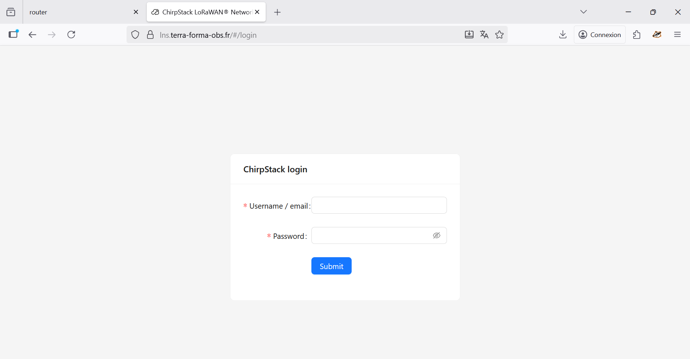
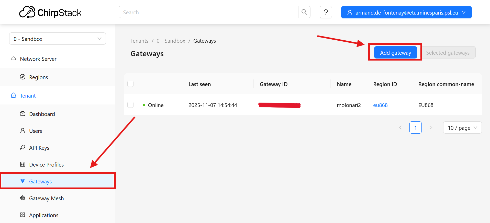
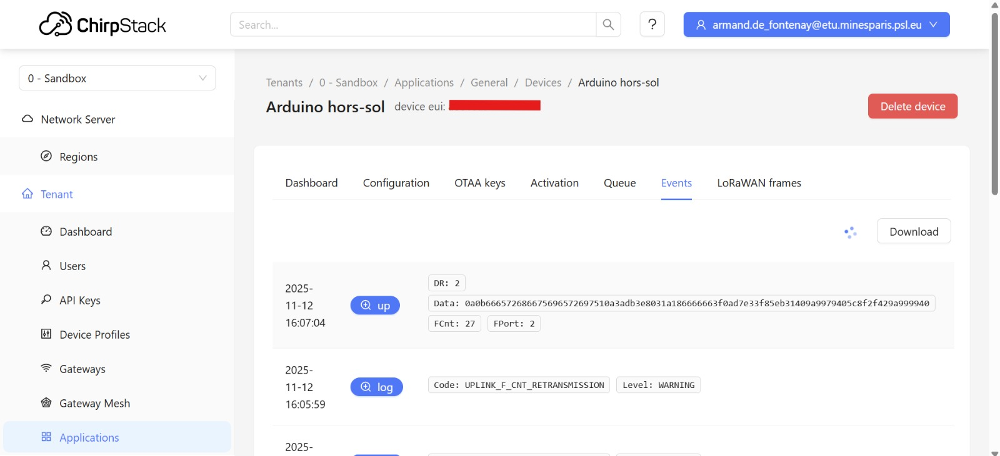

This was done in 2026 by Santiago Estrada (26Estrada)

# Onboarding ChirpStack Server

**This heading will be repeated *almost* verbatim for all Readmes**

This is the onboarding guide to the ChirpStack server. I will do my best to make it understandable and funny so you don't get as bored as I did. Whenever an AI intervention occurs (which may happen often), I will mark it down so you know. Call it my work-ethic (I hate reading AI generated content).

# Step 1: Connecting to the server
If Mr. Flipo told you there is a "server in Toulouse", he means this one. A tunnel that saves nothing, protects nothing, and is only used because of its legacy nature.

As mentioned in [Gateway documentation](../1-Gateway/README.md), you need the credentials to access the server at https://lns.terra-forma-obs.fr/. Again, Mr. Flipo has them. If he denies it, insist on it. Tell him that I (26Estrada) told you he has them (but don't tarnish my name). If none of that works, contact nabil.el_houssein@etu.minesparis.psl.eu (26elhousse) The login page looks like the following: 

# Step 2: Check Gateway Existence
Since this documentation assumes everything we did was not errased, the next step is to go to `Gateways` on the left menu after signing in. You should see an entry with an `Online` label. This means everything is fine.

# Step 3: Check Data Transmission
Everything is up and running. With your Relay and Sensor properly flashed, the Gateway on and connected, you can transmit data through LoRaWan. In the `Applications` section, you will be able to see new entries per sent package.

The data will be nonsense for you. It is encoded in Base64 with ProtoBuf libraries. To decode the data you may use my prototype decoder at https://github.com/santy-estrada/MOLO-64decoder.git.

## Help
If the server does not work or it is actually not configured, you will have to follow the tutorial done by the previous years. They are not as funny as me but it gets the job done.

https://github.com/flipoyo/MOLONARI1D/blob/main/hardware/specs/v2-2025/gateway/1%20-%20Server%20configuration.md
