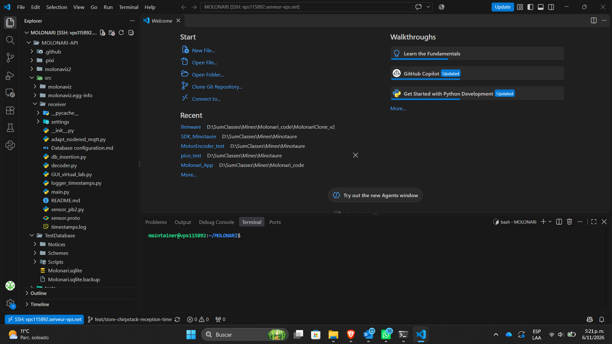
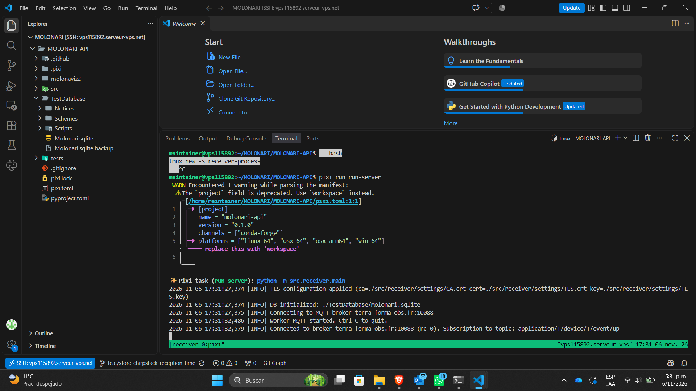

This was done in 2026 by Santiago Estrada (26Estrada)

# Onboarding VPS Receiver

**This heading will be repeated *almost* verbatim for all Readmes**

This is the onboarding guide to the Receiver on the VPS. I will do my best to make it understandable and funny so you don't get as bored as I did. Whenever an AI intervention occurs (which may happen often), I will mark it down so you know. Call it my work-ethic (I hate reading AI generated content).

# Step 1: Setting the Environment

<span style="color: green;">AI Assisted</span>

1. Open Visual Studio Code.
2. Open the **Extensions** view (`Ctrl+Shift+X`).
3. Search for **Remote - SSH** and install the extension published by Microsoft.
4. Open the Command Palette (`Ctrl+Shift+P`) and select **Remote-SSH: Connect to Host...**.
5. Select **Add New SSH Host...**, then enter the connection command, for example:
	```text
	ssh username@host-or-ip
	```
6. Select the SSH configuration file where the host should be saved.
7. Run **Remote-SSH: Connect to Host...** again and select the new host.
8. Choose the remote platform if prompted, then enter the SSH password or passphrase.

After the connection succeeds, VS Code opens a new window connected to the SSH host. Use **File > Open Folder...** to select the project directory on the remote machine.

<span style="color: green;">End of AI</span>

The `username` is `maintainer` unless Mr. Flipo tells you otherwise. The `host` and `password` (i.e., the credentials) should be asked to Mr. Flipo. He has them in his mail. 

# Step 2: What to Look For
Since this guide assumes that everything is as we left it in November 2026, I will assume the setup uses some commands. This doc should be changed if **YOU** change the code.

Go into the folder `MOLONARI/MOLONARI-API`. You will find a bunch of folders and python files that are apparently deprecated. They probably are, but some dependencies are embbeded into them. You can try to clean it up at your own risk. 

Your VS Code window should look as follows:



Notice that the down-left corner indicates that you are connected to a machine using SSH. At this point, you can tell your friends "I'm in", as if you were a true hacker.


## Step 3: Running the Receiver
Navigate in the terminal until you reach `~/MOLONARI/MOLONARI-API$`. Here, you will create a new `tmux` *session*. This will allow you to run a process and leave it active even if you close the ssh connection.

Run the following line. `receiver-process` can be changed to whatever you want if needed.

```bash
tmux new -s receiver-process
```

This will open a new terminal where you will actually run the process to capture data from ChirpStack and store it in a virtual machine. Now run:

```bash
pixi run run-server
```
You should get something like the following image, meaning that the server is up and running.



Whenever something is sent to ChirpStack, the server will intercept it, print the event in the terminal, and update the SQLite database. 

# Setp 4: Attaching and Detaching from a tmux
You may want to get your terminal back without stopping the process. Do not press `Ctrl + c`. Instead do `Ctrl + b` then `d`. It is important that you do it in that order for the terminal to detach from the tmux instead of ending the process.

If you want to attach to it again, open a terminal wherever and run:
```bash
tmux attach -t receiver-process
```

Remember to use the right process name. 

## Step 5: Visualizing the Data
Now that you have the entire system (sensor, relay, gateway, ChirpStack, and VPS receiver), you can visualize the data. SQLite was chosen by the previous years and kept for legacy reasons. 

`sqlite3` is already installed. You can navigate to `/home/maintainer/MOLONARI/MOLONARI-API/TestDatabase` and run `sqlite3 Molonari.sqlite` to open the DB.

### Some useful commands:
In the sqlite3 env...

- Use .tables to visualize all the existing tables.
- Use .exit to exit the environment
- The rest is SQL language (e.g., `SELECT * FROM [TABLE_NAME]`)

## Final Note:
This repo does not contain the VPS code used for the receiver. This can be found at https://github.com/flipoyo/MOLONARI-API in the appropriate branch. The README in that repo should be more detailed (and more AI generated).