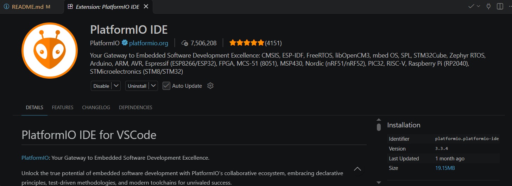
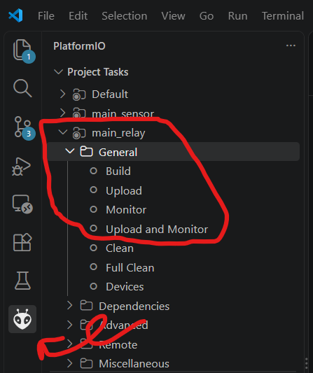
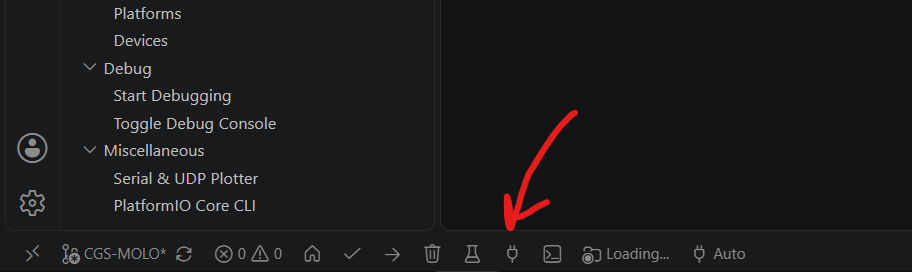

Written in 2026 by Nabil El Houssein (26elhousse)

# **Relay – Data Forwarding Node (MOLONARI 1D)**
This README explains how the relay firmware (main.cpp and main.hpp) works. The relay runs on an Arduino MKR WAN 1310 and sits right in the middle of the pipeline: it collects measurements from all the dataloggers over LoRa, backs them up on its SD card, and forwards everything to the gateway over LoRaWAN.

First, a quick warning before you waste any time: do not use or read `relay.ino`. That file is an old legacy entry point for the Arduino IDE. We only use PlatformIO now.   

## How the files are organized
Instead of cramming everything into one file or hardcoding numbers all over the place, the code is split between `main.cpp` and `main.hpp`. `main.hpp` holds the firmware version, the serial baud rate, the default SD pin, the file names (`conf.csv` and `RECORDS.CSV`), and the default timing constants like the 40-second slot duration. If you want to turn off serial debug logs to save power in the field, you can just comment out the `#define DEBUG_*` lines at the top of `main.hpp`.

`main.cpp` handles the actual logic inside `setup()` and `loop()`.

## How the relay works
When the Arduino boots up in `setup()`, it starts the serial monitor, reads `conf.csv` from the SD card, and falls back to the default values in `main.hpp` if any parameter is missing. It then sets up the LoRa radio as MASTER, checks that the SD card is working (if the SD card is missing or broken, it loops forever and stops here), initializes the external RTC clock, and links the logger to `RECORDS.CSV`.

Once in `loop()`, the relay doesn't just use a simple `delay()` because the clock would slowly drift out of sync with the dataloggers. Instead, everything is aligned to the external RTC clock. Every `lora_intervalle_secondes` (for example, every 240s), the relay wakes up at the exact start of the cycle and loops through all the dataloggers listed in `conf.csv` one by one:

1. It waits for the current datalogger's time slot (`i * time_window`). So datalogger 0 gets `0s–40s`, datalogger 1 gets `40s–80s`, and so on.
2. It switches the expected LoRa address to that specific datalogger's `devEui` (`lora.setAddressWaited(targetEui)`), does the handshake, receives all the measurements, and closes the session with a `FIN` packet.
3. It saves the received lines into `RECORDS.CSV` on the SD card. If a datalogger doesn't answer during its slot, the relay simply stops LoRa and moves on to the next datalogger in the list.

After talking to all the dataloggers, the relay uses the remaining time in the cycle to forward the data in `RECORDS.CSV` to the server over LoRaWAN (using `appEui` and `appKey`). It keeps track of where it stopped in the file using `lastSDOffset`, so if the connection drops or a packet fails after 3 retries, it breaks out of the loop and will retry from that exact line during the next cycle. Finally, when the cycle is done (or if the Arduino was turned on in the middle of a cycle), it calculates how many milliseconds are left until the next RTC window and goes to sleep using `waiter.sleepFor()`.

## Setting up `conf.csv`
I already wrote a detailed explanation of every single parameter inside `mains_ino/relay/conf.csv`, so go read the comments in that file before touching anything :) You can also generate a clean `conf.csv` using our Windows app ([https://github.com/flipoyo/MOLO-firmware-config](https://github.com/flipoyo/MOLO-firmware-config) or just edit it in Notepad.

The most important thing to remember for the relay's `conf.csv` is that you need one `devEui` line per datalogger, and you must list them in the exact order of their `datalogger_slot` index (0, then 1, etc.). Also, if you copy our `conf.csv` template onto the SD card, remove the # comment lines because a clean CSV is always safer.

## Flashing and running the code

1. Put your clean `conf.csv` at the root of the SD card and plug the SD card into the relay Arduino.
2. Open the firmware folder in VS Code with PlatformIO and upload using the `main_relay` environment:
    
    a. Download the `PlatformIO` IDE by `PlatformIO` extension in VS Code. It's the only extension you will need.

    

    b. On the left sidebar, click on the `PlatformIO` extension (it looks like an alien)
    
    c. Click on `main_relay` then `General`.
    
    d. Click on `Build` to build the code for the relay.
    
    

3. If you want to check the logs, open the `PlatformIO` serial monitor.
